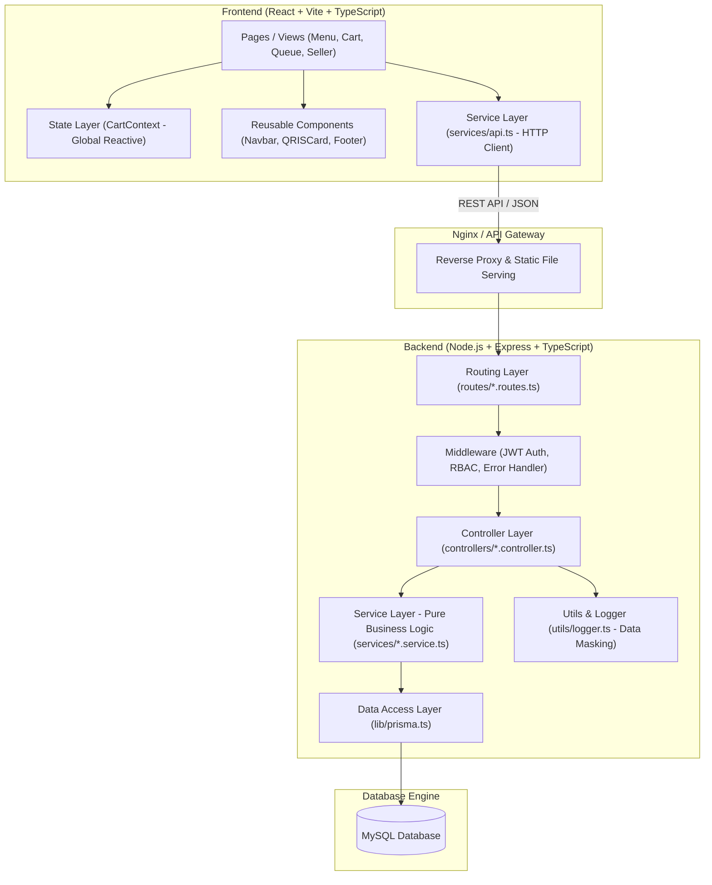

# ARSITEKTUR KODE DAN STRUKTUR FOLDER
**Proyek:** Sistem Antrean & Pemesanan Kantin Digital (Monorepo)  
**Mata Kuliah:** Rekayasa Perangkat Lunak (RPL)  
**Repositori:** `https://github.com/maxmillianoghazyllah-afk/project-rpl`  

---

## 1. Ringkasan Eksekutif

Aplikasi ini mengadopsi gabungan dari dua pola arsitektur industri teruji:
1. **Pola Tingkat Atas: Decoupled Monorepo Architecture**  
   Menyatukan kode `backend`, `frontend`, berkas infrastruktur, dan skrip automasi ke dalam satu repositori terpadu namun tetap terisolasi secara dependensi.
2. **Pola Backend: Layered Architecture (Multi-Tier / Clean Separation)**  
   Menerapkan pemisahan tugas secara tegas (*Separation of Concerns*) antara lapisan Routing, Controller, Service (Business Logic), dan Data Access (ORM Prisma).
3. **Pola Frontend: Feature & Component-Driven Modular Architecture**  
   Memisahkan komponen tampilan atomik (*reusable components*), halaman tampilan (*pages*), manajemen state reaktif (*context*), dan lapisan komunikasi jaringan (*services/api*).

---

## 2. Diagram Visual Arsitektur Sistem



---

## 3. Pohon Struktur Folder Lengkap (*Codebase Tree*)

Berikut adalah pemetaan struktur folder proyek yang logis, modular, dan terstandardisasi:

```text
RPL/ (Root Project Monorepo)
├── .github/                   # (Opsional) Workflow GitHub Actions
├── deployment/                # Berkas konfigurasi deploy bare-metal / server fisik
│   ├── rpi/                   # Skrip Raspberry Pi kiosk display
│   └── systemd/               # Unit daemon background service (systemd)
├── nginx/                     # Konfigurasi reverse proxy & sertifikat SSL
│   ├── conf.d/kantin.conf     # Konfigurasi routing domain / API proxy
│   └── ssl/                   # Kunci enkripsi HTTPS (CRT & KEY)
├── screenshot/                # Bukti visual pengujian & progres tugas mahasiswa
│   ├── git branch -a.png      # Bukti cabang v1.0, v1.0_dev, V1.1
│   ├── npm.cmd run pipeline fail.png  # Bukti penolakan pipeline (Merah)
│   ├── npm.cmd run pipeline.png       # Bukti 200 UT lolos (Hijau)
│   └── Auto-Build.png         # Bukti keberhasilan kompilasi build
├── scripts/                   # Automasi DevOps & CI/CD Pipeline
│   ├── ci-cd-pipeline.js      # Otomasi pengujian 200 UT -> Auto-Build -> Deploy Live
│   ├── run-test-fail.js       # Runner simulasi kegagalan pengujian
│   └── create-github-issues.js# Skrip pencatatan tiket issues otomatis
│
├── backend/                   # [BACKEND SERVICE] Node.js, Express, Prisma ORM
│   ├── prisma/                # Lapisan Database & Migrasi
│   │   ├── schema.prisma      # Definisi skema entitas database (User, Menu, Order, Queue)
│   │   └── seed.ts            # Data awal default untuk pengujian & demo
│   ├── src/
│   │   ├── controllers/       # [LAPISAN KONTROLER] Menangani Request/Response HTTP
│   │   │   ├── auth.controller.ts
│   │   │   ├── menu.controller.ts
│   │   │   ├── order.controller.ts
│   │   │   ├── payment.controller.ts
│   │   │   └── queue.controller.ts
│   │   ├── services/          # [LAPISAN SERVICE] Murni Logika Bisnis (Domain Logic)
│   │   │   ├── auth.service.ts       # Hash password, validasi email, RBAC
│   │   │   ├── menu.service.ts       # Sanitasi nama menu, validasi range harga
│   │   │   ├── order.service.ts      # Kalkulasi item, generate nomor pesanan
│   │   │   ├── payment.service.ts    # Rekonsiliasi nominal QRIS, status pembayaran
│   │   │   ├── promotion.service.ts  # Mesin promo voucher, diskon cap, takeaway fee
│   │   │   └── queue.service.ts      # Format nomor antrean, estimasi waktu tunggu
│   │   ├── routes/            # [LAPISAN ROUTING] Pemetaan Endpoint URL REST API
│   │   │   ├── index.ts              # Penggabung seluruh router
│   │   │   ├── auth.routes.ts
│   │   │   ├── menu.routes.ts
│   │   │   ├── order.routes.ts
│   │   │   ├── payment.routes.ts
│   │   │   └── queue.routes.ts
│   │   ├── middleware/        # [LAPISAN FILTER] Autentikasi & Otorisasi
│   │   │   └── auth.ts               # Verifikasi Bearer Token JWT & Role SELLER
│   │   ├── lib/               # [LAPISAN INFRASTRUKTUR] Singleton Client
│   │   │   └── prisma.ts             # Instansiasi PrismaClient tunggal (Connection Pool)
│   │   ├── utils/             # [LAPISAN UTILITAS] Helper Umum
│   │   │   └── logger.ts             # Logger sistem dengan penyamaran data sensitif (Masking)
│   │   ├── app.ts             # Konfigurasi aplikasi Express & Global Middleware
│   │   └── server.ts          # Entry point bootstrap server (Port listener)
│   ├── tests/                 # [SUITE 200 UNIT TESTS]
│   │   ├── test-harness.ts    # Runner pengujian mandiri tanpa framework berat
│   │   ├── order_promo.test.ts    # 40 UT (Pemesanan & Voucher)
│   │   ├── queue_timing.test.ts   # 35 UT (Antrean & Waktu Tunggu)
│   │   ├── payment_recon.test.ts  # 35 UT (Validasi Pembayaran QRIS)
│   │   ├── menu_stock.test.ts     # 30 UT (Menu & Kontrol Stok)
│   │   ├── auth_rbac.test.ts      # 30 UT (Autentikasi & Hak Akses)
│   │   ├── security_safe.test.ts  # 30 UT (Data Masking & Keamanan)
│   │   └── run-all-tests.ts   # Orkestrator eksekusi 200 UT
│   ├── package.json           # Dependensi modul backend
│   └── tsconfig.json          # Konfigurasi TypeScript backend
│
├── frontend/                  # [FRONTEND SERVICE] React, Vite, Tailwind CSS
│   ├── src/
│   │   ├── components/        # [KOMPONEN ATOMIK REUSABLE]
│   │   │   ├── Navbar.tsx            # Bar navigasi utama & indikator keranjang
│   │   │   ├── Footer.tsx            # Footer aplikasi
│   │   │   ├── QRISCard.tsx          # Kartu display kode QRIS dinamis
│   │   │   └── SellerAuthModal.tsx   # Modal autentikasi penjual kantin
│   │   ├── context/           # [STATE MANAGEMENT GLOBAL]
│   │   │   └── CartContext.tsx       # Penyimpan keranjang reaktif & sync LocalStorage
│   │   ├── pages/             # [HALAMAN / VIEWS ROUTER]
│   │   │   ├── MenuPage.tsx          # Katalog menu & pemilihan pesanan mahasiswa
│   │   │   ├── CartPage.tsx          # Rincian keranjang belanja & input voucher promo
│   │   │   ├── PaymentInstructionPage.tsx # Panduan transfer / bayar QRIS
│   │   │   ├── QueueStatusPage.tsx   # Tampilan nomor antrean & estimasi waktu tunggu
│   │   │   ├── OrderHistoryPage.tsx  # Riwayat transaksi mahasiswa
│   │   │   └── seller/               # Sub-halaman khusus Penjual
│   │   │       ├── SellerDashboardPage.tsx # Manajemen antrean masuk & konfirmasi bayar
│   │   │       └── SellerMenuPage.tsx      # Kelola ketersediaan menu & tambah menu baru
│   │   ├── services/          # [LAPISAN API CLIENT]
│   │   │   └── api.ts                # Abstraksi pemanggilan HTTP REST API ke backend
│   │   ├── types/             # [KONTRAK TIPE DATA]
│   │   │   └── index.ts              # Definisi interface TypeScript (Order, Menu, CartItem, User)
│   │   ├── App.tsx            # Router utama aplikasi & tata letak (layout)
│   │   ├── main.tsx           # Entry point React DOM render
│   │   └── index.css          # Tailwind CSS directives
│   ├── package.json           # Dependensi modul frontend
│   ├── tailwind.config.js     # Desain token Tailwind CSS
│   ├── tsconfig.json          # Konfigurasi TypeScript frontend
│   └── vite.config.ts         # Konfigurasi bundler Vite & proxy pengujian lokal
│
├── docker-compose.yml         # Orkestrasi multi-container lokal (Backend, Frontend, DB)
├── package.json               # Konfigurasi Workspace Monorepo
├── vercel.json                # Pengaturan hosting serverless cloud Vercel
├── LAPORAN_P11_CI_CD_TESTING.md # Laporan pengujian otomatis P11
└── README.md                  # Dokumentasi umum proyek
```

---

## 4. Penjelasan Detail Setiap Lapisan & Tanggung Jawabnya

### A. Lapisan Backend (Prinsip *Separation of Concerns*)

1. **`routes/` (Routing Layer):**
   - **Tanggung Jawab:** Hanya bertugas memetakan URL endpoint (`GET /api/orders`, `POST /api/orders`) ke fungsi controller yang sesuai dan memasang middleware keamanan.
   - **Prinsip:** Tidak boleh ada logika kalkulasi bisnis atau manipulasi database di berkas route.

2. **`controllers/` (Presentation / HTTP Layer):**
   - **Tanggung Jawab:** Menangani objek HTTP `Request` dan `Response`. Mengambil data dari `req.body` atau `req.params`, melakukan validasi tipe dasar, memanggil Service Layer, dan mengembalikan status code (`200 OK`, `400 Bad Request`, `404 Not Found`, `500 Internal Error`).
   - **Prinsip:** Controller tidak melakukan perhitungan matematika pesanan atau diskon secara langsung; pekerjaan berat tersebut didelegasikan ke Service.

3. **`services/` (Domain Business Logic Layer):**
   - **Tanggung Jawab:** Menjadi "otak" aplikasi. Berisi fungsi-fungsi murni (*pure functions*) yang menjalankan aturan bisnis: perhitungan harga, diskon voucher promo, estimasi menit antrean, format nomor pesanan, dan verifikasi pembayaran.
   - **Prinsip:** Lapisan ini dirancang **independen dari Express.js** (`req`/`res`). Dampaknya, seluruh fungsi service dapat diuji secara langsung oleh Unit Test (UT) tanpa perlu menyalakan server web.

4. **`lib/` & `prisma/` (Data Access Layer / Infrastructure):**
   - **Tanggung Jawab:** Menangani komunikasi fisik dengan basis data MySQL melalui Prisma ORM. Menjamin koneksi *connection pool* bersifat singleton sehingga efisien dan mencegah *memory leak*.

5. **`middleware/` (Cross-Cutting Concerns):**
   - **Tanggung Jawab:** Menyaring permintaan HTTP sebelum mencapai controller. Memverifikasi validitas token JWT dan memeriksa hak akses peran (*Role-Based Access Control* / RBAC) untuk membedakan hak akses `CUSTOMER` dan `SELLER`.

6. **`utils/` (Helper & Security Utilities):**
   - **Tanggung Jawab:** Fungsi pendukung seperti `logger.ts` yang dilengkapi algoritma *data masking* untuk otomatis menyensor kata sandi, PIN, dan token sebelum dicatat ke log sistem.

---

### B. Lapisan Frontend (Prinsip *Component-Driven & Modular*)

1. **`components/` (Shared / Reusable UI):**
   - **Tanggung Jawab:** Komponen visual generik yang digunakan di banyak tempat (misal: `Navbar` yang muncul di setiap halaman, `QRISCard` untuk menampilkan QR code). Komponen ini bersifat modular dan menerima input lewat `props`.

2. **`pages/` (View Containers):**
   - **Tanggung Jawab:** Merepresentasikan satu layar tampilan penuh yang diakses pengguna berdasarkan rute URL. Folder `pages/seller/` sengaja dipisahkan agar modul penjual kantin terisolasi rapi dari modul mahasiswa pembeli.

3. **`context/` (Reactive State Management):**
   - **Tanggung Jawab:** Menyediakan status global aplikasi yang dapat diakses oleh komponen mana pun tanpa perlu *prop-drilling*. `CartContext.tsx` mengelola daftar belanjaan di keranjang secara reaktif serta otomatis melakukan sinkronisasi dengan `localStorage` browser.

4. **`services/api.ts` (Network / HTTP Client Abstraction):**
   - **Tanggung Jawab:** Mengisolasi seluruh perintah `fetch`/HTTP request ke backend. Halaman UI tidak pernah memanggil `fetch('/api/...')` secara langsung, melainkan melalui fungsi terdefinisi seperti `api.createOrder()` atau `api.getMenus()`.
   - **Keuntungan:** Jika URL backend atau struktur API berubah di masa depan, perubahan hanya perlu dilakukan di satu berkas ini saja.

5. **`types/` (Type Contracts):**
   - **Tanggung Jawab:** Menyimpan cetak biru tipe data TypeScript (`Menu`, `Order`, `CartItem`, `UserRole`). Menjamin konsistensi data antara apa yang dikirim backend dan apa yang diterima frontend (*Type Safety*).

---

## 5. Alasan & Argumen Teknis: Kenapa Memilih Arsitektur Folder Ini?

Pemilihan arsitektur ini didasarkan pada prinsip-prinsip rekayasa perangkat lunak modern:

### 1. *Separation of Concerns* (SoC) & *Single Responsibility Principle* (SRP)
Setiap folder memiliki satu tanggung jawab yang jelas.
- Programmer yang ingin mengubah tampilan UI hanya perlu membuka folder `frontend/src/components/` atau `pages/`.
- Programmer yang ingin mengubah aturan bisnis diskon hanya perlu menyentuh `backend/src/services/promotion.service.ts`.
- Hal ini mencegah terjadinya *Spaghetti Code* (kode yang saling bertumpuk antara tampilan, SQL, dan logika bisnis dalam satu file).

### 2. Kemudahan Pengujian Ekstrem (*Extreme Testability*)
Karena logika bisnis diisolasi di dalam `backend/src/services/` tanpa terikat pada Express `req/res`, tim pengembang dapat dengan mudah menulis dan mengeksekusi **200 Unit Tests** dengan kecepatan tinggi (< 2 detik). Tidak perlu melakukan *mocking* server HTTP yang rumit.

### 3. Kemudahan Kolaborasi Tim (*Maintainability & Low Cognitive Load*)
Struktur folder ini sangat intuitif. Pengembang baru (*onboarding developer*) atau dosen penilai dapat langsung menebak letak suatu fitur hanya dengan membaca nama foldernya:
- Ingin melihat logika autentikasi? Buka `backend/src/services/auth.service.ts`.
- Ingin melihat tampilan dashboard penjual? Buka `frontend/src/pages/seller/SellerDashboardPage.tsx`.

### 4. Keuntungan Pola Monorepo (*Unified Workspace*)
- **Sinkronisasi Kode:** Perubahan pada struktur data pesanan di backend dapat langsung disesuaikan pada `types/` di frontend dalam satu commit Git.
- **Automasi CI/CD Terpadu:** Skrip `scripts/ci-cd-pipeline.js` dapat menjalankan pengujian unit test backend dan sekaligus memicu kompilasi frontend (`vite build`) dalam satu siklus pengujian berkelanjutan.
- **Penyederhanaan Deployment:** Memudahkan proses deploy ke platform cloud modern (seperti Vercel atau Docker Compose) tanpa harus memelihara dua repositori terpisah.

### 5. Kesiapan Menuju Skalabilitas (*Scalability & Future Evolution*)
Jika di masa mendatang aplikasi ini bertumbuh pesat dan sistem antrean ingin dipisahkan menjadi *Microservice* tersendiri:
- Tim cukup memindahkan folder `services/queue.service.ts` dan `controllers/queue.controller.ts` ke dalam kontainer baru.
- Tidak ada kode UI frontend yang rusak karena komunikasi sudah terabstraksi di `services/api.ts`.

---

## 6. Kesimpulan

Arsitektur folder yang diterapkan pada proyek ini **sangat masuk akal (*make sense*)**, mengikuti standar baku industri (*industry best practices*), serta memberikan keseimbangan optimal antara kerapian kode (*clean code*), kemudahan pengujian (*testability*), dan kesiapan operasional (*production-ready*).
