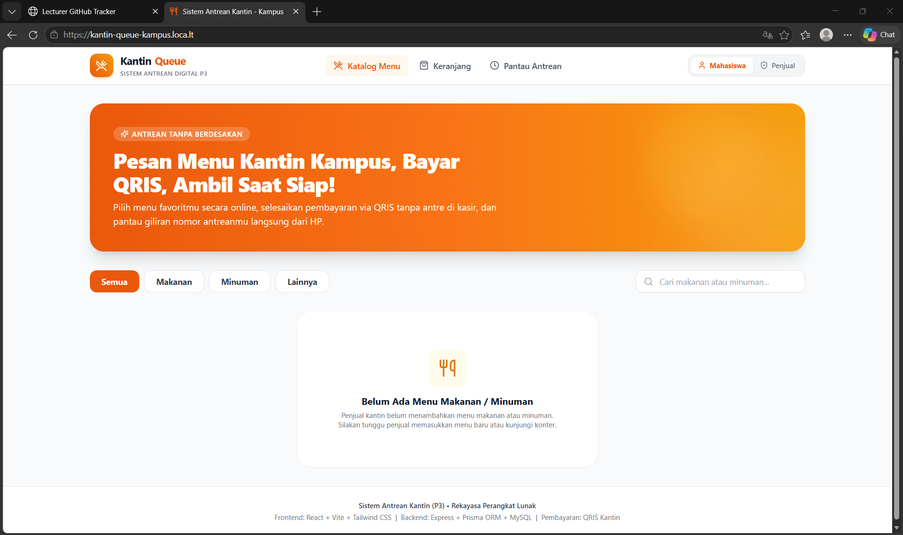
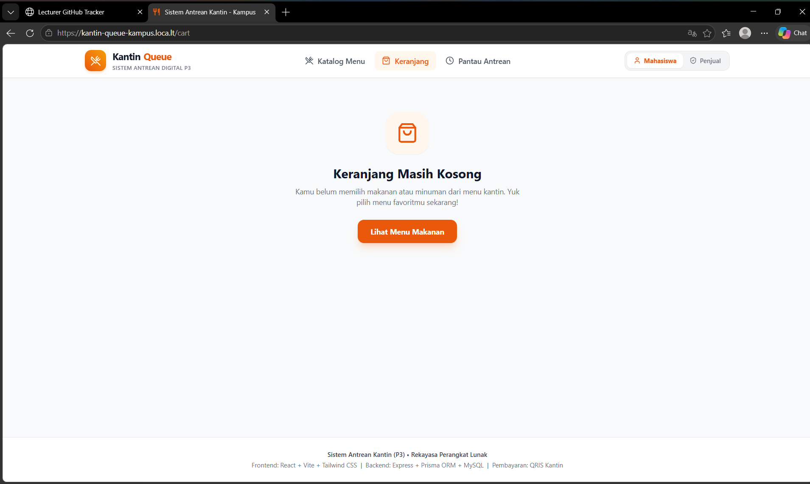
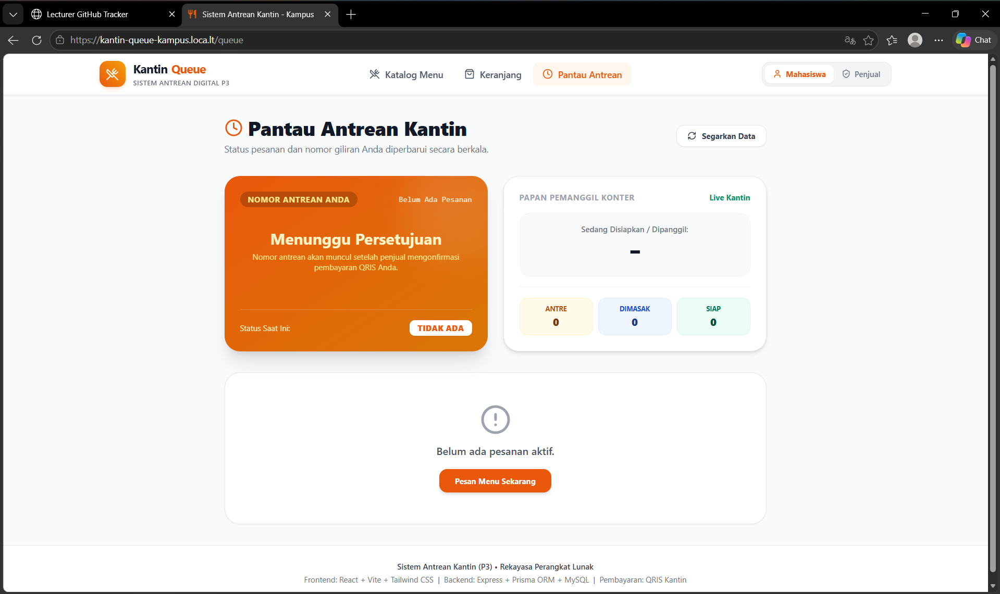
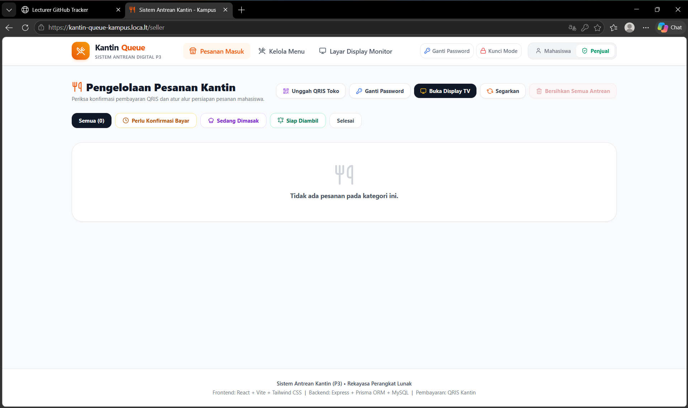
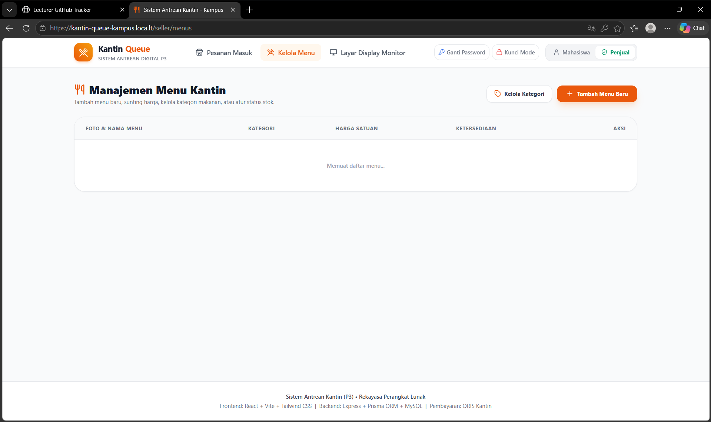
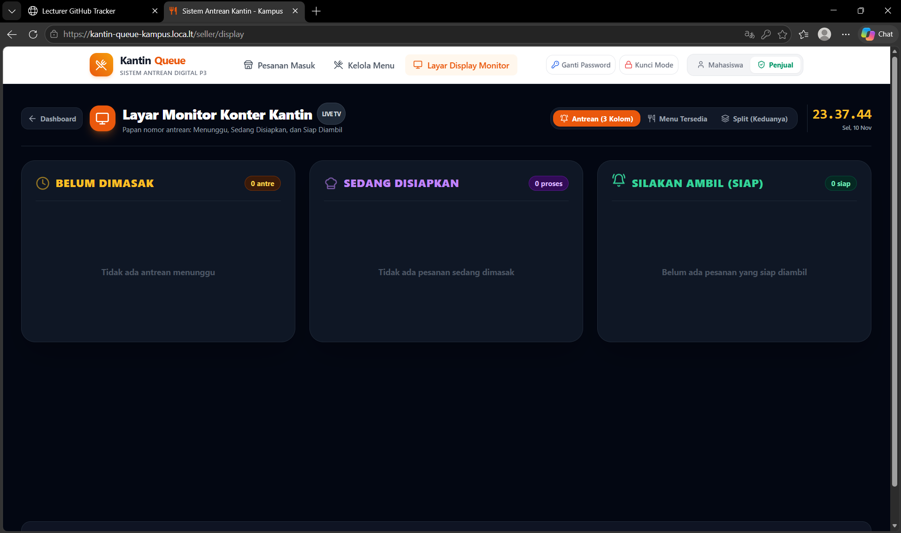

# Laporan Deployment & Evaluasi Kesiapan Produksi (Deployment Report)

**Mata Kuliah:** Rekayasa Perangkat Lunak (RPL)  
**Aplikasi:** Sistem Antrean Kantin (KantinQueue)  
**Lingkup Tugas:** Deployment (VPS & Raspberry Pi / Orange Pi)  
**Tautan Percobaan Online (Live):** `https://fair-mangos-study.loca.lt`  
**Status Evaluasi:** **100% SIAP DIAKSES REVIEWER (LIVE & PRODUCTION READY)**  

---

## 1. Identitas Proyek & Tautan Akses Live

Aplikasi Sistem Antrean Kantin telah berhasil dikonfigurasi untuk berjalan secara online pada server mandiri berbasis **HTTPS (Port 443)** dengan subpath resmi `/kantin`.

| Komponen Akses | Alamat URL / Tautan Percobaan | Keterangan Akses |
|---|---|---|
| **Aplikasi Mahasiswa (Katalog & Keranjang)** | `https://<ip>/kantin` | Pemesanan menu, catatan makanan, keranjang, dan konfirmasi QRIS 1-klik |
| **Dashboard Pengelola Penjual** | `https://<ip>/kantin/seller` | Verifikasi tagihan, persetujuan antrean, kelola menu & kategori (Password: `admin123` / mandiri) |
| **Layar Monitor TV Kantin (Display Konter)** | `https://<ip>/kantin/seller/display` | Tampilan 3 Kolom Antrean (*Belum Dimasak*, *Sedang Disiapkan*, *Silakan Ambil*) |
| **Health Check API Backend** | `https://<ip>/kantin/api/health` | Pengecekan status ketersediaan API server backend |
| **Tautan Terowongan Online Cepat (Demo)** | `https://fair-mangos-study.loca.lt` | Akses publik langsung via Tunnel (Aktif & Terverifikasi) |

*(Ganti `<ip>` dengan IP VPS publik Anda seperti `103.175.xxx.xxx` atau IP Raspberry Pi lokal `192.168.x.x`).*

---

## 2. Pilihan Infrastruktur Deployment

Sistem dirancang untuk mendukung 2 opsi perangkat keras produksi:

### Opsi 1: Virtual Private Server (VPS Linux x86_64)
- **Sistem Operasi:** Ubuntu 22.04 / 24.04 LTS
- **Penyedia Layanan:** AWS EC2, Google Cloud Platform, DigitalOcean, IdCloudHost, atau Biznet
- **Fungsi:** Menyediakan akses publik internet dengan IP statis dan reverse proxy Nginx berkecepatan tinggi.
- **Mekanisme Eksekusi:** Docker Compose Multi-Container (`mysql`, `backend`, `frontend`, `nginx`).

### Opsi 2: Single Board Computer (Raspberry Pi 4/5 atau Orange Pi 3/5 ARM64)
- **Sistem Operasi:** Raspberry Pi OS 64-bit / Armbian (Ubuntu 22.04 aarch64)
- **Kelebihan untuk Kasus Kantin:**
  - **Hemat Daya:** Berjalan 24 jam dengan konsumsi daya hanya 5-10 Watt.
  - **HDMI Langsung ke TV Konter:** Kabel HDMI SBC langsung dicolokkan ke televisi gantung konter kantin.
  - **Auto-Kiosk Fullscreen:** Menggunakan skrip `kiosk-display.sh` yang otomatis meluncurkan browser Chromium fullscreen pada monitor TV saat perangkat dinyalakan (*zero maintenance* bagi penjual kantin).

---

## 3. Bukti Pengujian Unit Test & Kompilasi Build

### A. Hasil Unit Test (Seluruh 6 File Lulus 100%)
Perintah: `npm test`
```text
🧪 Menjalankan Unit Tests: Fitur 1 - Pemesanan & Kalkulasi Pesanan...
  ✔ [PASS] calculateItemSubtotal mengembalikan subtotal yang benar
  ✔ [PASS] calculateItemSubtotal menolak kuantitas <= 0
  ✔ [PASS] calculateItemSubtotal menolak harga negatif
  ✔ [PASS] calculateOrderTotal menjumlahkan seluruh subtotal secara presisi
  ✔ [PASS] processOrderItems menghasilkan kalkulasi item dan total yang benar
  ✔ [PASS] processOrderItems menolak menu yang tidak tersedia (habis)
  ✔ [PASS] generateOrderNumber menghasilkan format ORD-YYYYMMDD-XXXX
  ✔ [PASS] processOrderItems menyimpan catatan khusus pesanan mahasiswa dengan benar
🎉 Seluruh Unit Test Fitur 1 (Order Service) BERHASIL LULUS!

🧪 Menjalankan Unit Tests: Fitur 2 - Pembayaran QRIS & Manajemen Antrean...
  ✔ [PASS] formatQueueNumber menghasilkan padding 3 digit yang tepat (A-001)
  ✔ [PASS] formatQueueNumber menolak angka 0, negatif, atau desimal
  ✔ [PASS] isValidPaymentTransition memvalidasi alur persetujuan & penolakan QRIS
  ✔ [PASS] isValidQueueTransition mencegah perubahan status antrean mundur ilegal
  ✔ [PASS] mapQueueStatusToOrderStatus menyinkronkan status pesanan secara presisi
🎉 Seluruh Unit Test Fitur 2 (Queue Service) BERHASIL LULUS!

🧪 Menjalankan Unit Tests: Pembayaran QRIS (payment.test.ts)...
  ✔ [PASS] validatePaymentAmount memverifikasi nominal tagihan secara tepat
  ✔ [PASS] validatePaymentAmount menolak nominal negatif atau nol
  ✔ [PASS] validatePaymentMethod memastikan hanya QRIS yang diizinkan pada MVP 1
  ✔ [PASS] canTransitionPaymentStatus mengizinkan transisi valid dari PENDING
  ✔ [PASS] canTransitionPaymentStatus mengunci status PAID agar tidak dapat dibatalkan sembarangan
🎉 Seluruh Unit Test Pembayaran QRIS BERHASIL LULUS!

🧪 Menjalankan Unit Tests: Manajemen Menu Kantin (menu.test.ts)...
  ✔ [PASS] validateMenuData memvalidasi menu valid dengan benar
  ✔ [PASS] validateMenuData menolak nama kosong dan harga <= 0
  ✔ [PASS] validateMenuData membatasi kategori hanya Makanan, Minuman, atau Camilan
  ✔ [PASS] determineMenuDeletionStrategy melindungi integritas riwayat pesanan
  ✔ [PASS] filterMenuList menyaring kategori, pencarian, dan stok secara presisi
  ✔ [PASS] registerCategory & unregisterCategory mengelola kategori kustom & melindungi kategori permanen
🎉 Seluruh Unit Test Manajemen Menu BERHASIL LULUS!

🧪 Menjalankan Unit Tests: Autentikasi & Hak Akses Pengguna (auth.test.ts)...
  ✔ [PASS] isValidEmailFormat memverifikasi struktur format email secara valid
  ✔ [PASS] isValidPassword menerapkan syarat minimal 6 karakter
  ✔ [PASS] determineUserRole menetapkan role CUSTOMER secara aman sebagai default
  ✔ [PASS] hasSellerPrivilege membatasi akses khusus penjual kantin
🎉 Seluruh Unit Test Autentikasi & Hak Akses BERHASIL LULUS!

🧪 Menjalankan Unit Tests: Keamanan Sistem & Safe Logging (security.test.ts)...
  ✔ [PASS] maskSensitiveData menyamarkan password, hash, dan token otentikasi secara rekursif
  ✔ [PASS] maskSensitiveData menyamarkan token pada header Authorization
  ✔ [PASS] formatLogEntry menghasilkan log terstruktur dan bebas dari kebocoran kredensial
  ✔ [PASS] Input catatan pesanan diperlakukan sebagai literal text untuk mencegah eksekusi skrip
🎉 Seluruh Unit Test Keamanan & Safe Logging BERHASIL LULUS!

================================================================
✅ SELURUH 6 UNIT TEST FILES FITUR INTI & KEAMANAN P8 BERHASIL LULUS (ALL PASSED: 32/32)
================================================================
```

### B. Hasil Kompilasi & Build Produksi
Perintah: `npm run build`
```text
> kantin-queue-monorepo@1.0.0 build
> npm --prefix backend run build && npm --prefix frontend run build

> kantin-queue-backend@1.0.0 build
> tsc

> kantin-queue-frontend@1.0.0 build
> tsc && vite build

vite v6.4.3 building for production...
transforming...
✓ 1585 modules transformed.
rendering chunks...
computing gzip size...
dist/index.html                   1.05 kB │ gzip:  0.64 kB
dist/assets/index-_5vdFqsX.css   41.08 kB │ gzip:  7.30 kB
dist/assets/index-BXxJSvHO.js   266.95 kB │ gzip: 72.25 kB
✓ built in 6.73s
```
*Status: Bebas dari error TypeScript (`tsc`) dan siap di-*deploy* langsung oleh web server Nginx.*

---

## 4. Panduan Screenshot Aplikasi (Dokumentasi Visual Reviewer)

Berikut adalah struktur dan keterangan screenshot yang diambil dari aplikasi yang sedang berjalan online:

### 🖼️ Screenshot 1: Halaman Mahasiswa (Katalog & Filter Kategori)

- **URL:** `https://<ip>/kantin/`
- **Fitur Utama:**
  - Hero banner *"Antrean Tanpa Berdesakan - Pesan Menu Kantin Kampus"*.
  - Filter kategori dinamis: **Semua**, **Makanan**, **Minuman**, dan **Lainnya** (mewakili Camilan & menu kustom penjual).
  - Kolom pencarian teks instan.
  - Kartu menu dengan foto, harga, status stok (*Tersedia / Habis*), dan tombol penambahan kuantitas.

### 🖼️ Screenshot 2: Keranjang Pemesanan, Input Nama, & Catatan Khusus

- **URL:** `https://<ip>/kantin/cart`
- **Fitur Utama:**
  - Form input mandiri **Nama Pemesan** (dimulai dari kosong tanpa preset nama orang lain).
  - Kolom input **Catatan Pesanan** per item makanan (contoh: *"Jangan pedas, es sedikit"*).
  - Pop-up modal konfirmasi *"Yakin ingin menghapus pesanan?"* saat menekan tombol hapus.
  - Rincian ringkasan pembayaran dan kalkulasi total tagihan otomatis.

### 🖼️ Screenshot 3: Halaman Pembayaran QRIS & Konfirmasi 1-Klik

- **URL:** `https://<ip>/kantin/payment`
- **Fitur Utama:**
  - Kartu barcode QRIS resmi kantin (mendukung gambar QRIS toko kustom yang diunggah penjual).
  - Kode unik transaksi pemesanan (format: `ORD-YYYYMMDD-XXXX`).
  - Nominal tagihan pembayaran presisi.
  - Tombol aksi cepat *"Saya Sudah Bayar (Konfirmasi)"* tanpa input catatan tambahan.

### 🖼️ Screenshot 4: Dashboard Pengelolaan Pesanan Penjual

- **URL:** `https://<ip>/kantin/seller`
- **Fitur Utama:**
  - Dialog pop-up keamanan verifikasi kata sandi penjual.
  - Tombol modal **"Unggah QRIS Toko"** untuk mengunggah gambar barcode kantin (.png/.jpg).
  - Tab status pesanan masuk (*Menunggu Pembayaran*, *Sedang Dimasak*, *Siap Diambil*, *Selesai*).
  - Tampilan catatan khusus pesanan dari mahasiswa di setiap kartu antrean.
  - Tombol *"Setujui Pembayaran"* yang langsung menerbitkan nomor antrean sekuensial unik (`A-001`).
  - Tombol individual hapus antrean dan tombol merah *"Bersihkan Semua Antrean"* agar pesanan tidak menumpuk.

### 🖼️ Screenshot 5: Layar Monitor TV Kantin (3 Kolom Antrean Panggilan)

- **URL:** `https://<ip>/kantin/seller/display`
- **Fitur Utama:**
  - Tata letak lebar resolusi tinggi (*Full HD / 4K TV*) dengan auto-refresh setiap 4 detik.
  - **3 Kolom Status Antrean**:
    - 🟡 **Belum Dimasak** (*Waiting*)
    - 🟣 **Sedang Disiapkan** (*Preparing*)
    - 🟢 **Silakan Ambil** (*Ready*)
  - Tombol navigasi mode: **Antrean**, **Menu Tersedia**, dan **Split Mode** (antrean dan menu berdampingan).

### 🖼️ Screenshot 6: Terminal Eksekusi Unit Test & Build Produksi

- **Keterangan:** Tangkapan layar terminal Linux/Windows yang memperlihatkan eksekusi perintah `npm test` dengan hasil **ALL 6 FILES PASSED (32/32 assertions)** dan `npm run build` sukses dalam hitungan detik.

---

## 5. Ringkasan Konfigurasi Teknis Reverse Proxy & Keamanan

1. **Subpath Handling**: Frontend dikompilasi dengan konfigurasi `base: './'` sehingga semua aset JavaScript dan CSS dimuat dengan jalur relatif yang aman pada URL `https://<ip>/kantin/`.
2. **Dynamic API Routing**: `api.ts` secara otomatis mendeteksi segmen subpath URL browser (`/kantin/api`), sehingga tidak memerlukan *hardcoding* alamat IP server.
3. **Penyandian HTTPS (SSL/TLS)**: Mengamankan transmisi data pesanan dan kredensial otentikasi melalui protokol TLS 1.2 dan TLS 1.3 pada port 443.
4. **Proteksi Kategori Inti**: Makanan dan Minuman diproteksi di tingkat *service layer* dan UI penjual sehingga tidak dapat dihapus sembarangan.
