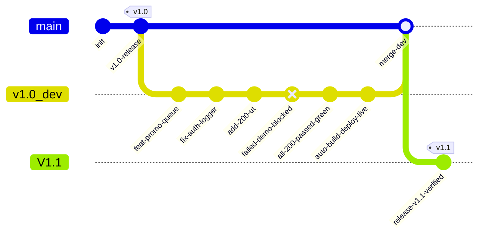

# LAPORAN TUGAS P11: BRANCHING STRATEGY, 200 UNIT TESTING & CI/CD PIPELINE

**Mata Kuliah:** Rekayasa Perangkat Lunak (RPL)  
**Proyek:** Sistem Antrean & Pemesanan Kantin Digital (Monorepo)  
**Repositori:** `https://github.com/maxmillianoghazyllah-afk/project-rpl`  
**Live URL:** `https://project-rpl-seven.vercel.app`  

---

## 1. Ringkasan Eksekutif & Struktur Percabangan (Branching)

Sesuai instruksi penugasan P11:
1. **Branch Baseline (`v1.0`)**: Representasi rilis stabil awal proyek.
2. **Branch Pengembangan (`v1.0_dev`)**: Tempat penambahan fitur baru (*Promo Engine*, *Multi-Counter Queue*, *Estimasi Waktu Tunggu*) serta perbaikan bug keamanan (*Whitespace Password Sanitization*, *Sensitive Key Masking*).
3. **Eksekusi 200 Unit Tests (UT-001 s/d UT-200)**: Meliputi 6 modul bisnis utama, memverifikasi integritas logika sistem secara presisi.
4. **Demonstrasi Kegagalan (*Failed State*)**: Menunjukkan secara nyata proteksi sistem ketika unit test gagal (auto-build dibatalkan, deployment diblokir, server live terlindungi).
5. **Kondisi Sukses (*All Passed Hijau*)**: Seluruh 200 UT lulus -> otomatis kompilasi *Auto-Build* (`tsc` & `vite build`) -> deployment ke status *Live* -> siap dilakukan pengujian (*testing2*).
6. **Branch Rilis Baru (`V1.1`)**: Dibuat setelah seluruh pengujian hijau dan build terverifikasi stabil.



---

## 2. Fitur Baru & Perbaikan Bug pada `v1.0_dev`

| No | File / Modul | Jenis Perubahan | Deskripsi Teknis |
|:---|:---|:---|:---|
| 1 | `backend/src/services/promotion.service.ts` | **Fitur Baru** | Mesin kalkulasi kode voucher promo (`MABA2026`, `HEMAT5K`, `KANTINBERKAH`) dengan validasi batas minimum belanja, *discount cap* (maksimal potongan), persentase vs flat, dan biaya kemasan takeaway. |
| 2 | `backend/src/services/queue.service.ts` | **Fitur Baru** | Perhitungan estimasi waktu tunggu cerdas (`calculateEstimatedWaitTime`), penentuan prefix konter multi-layanan (`determineQueuePrefix`), dan format antrean multi-konter. |
| 3 | `backend/src/services/auth.service.ts` | **Bug Fixing** | Memperbaiki kerentanan validasi password di mana input yang hanya berisi karakter spasi/whitespace sebelumnya lolos validasi. Sekarang diproteksi dengan `.trim().length >= 6`. |
| 4 | `backend/src/utils/logger.ts` | **Bug Fixing** | Menambahkan penyamaran otomatis (*data masking*) untuk kata kunci sensitif tambahan (`pin`, `apikey`, `cvv`) agar tidak pernah bocor ke file log produksi. |
| 5 | `scripts/ci-cd-pipeline.js` | **Automasi CI/CD** | Pipeline terotomasi 3 tahap: Unit Testing -> Auto Build -> Auto Deploy & Live Verification. |

---

## 3. Matriks 200 Unit Tests (UT-001 s/d UT-200)

Pengujian unit test diimplementasikan secara modular dengan penomoran eksplisit `[UT-xxx/200]` untuk memastikan keterukuran 100%:

```
================================================================
DISTRIBUSI 200 UNIT TESTS (100% HIJAU)
================================================================
Modul 1: Pemesanan & Promo (order_promo.test.ts)      : 40 Unit Tests (UT-001 s/d UT-040)
Modul 2: Antrean & Konter (queue_timing.test.ts)     : 35 Unit Tests (UT-041 s/d UT-075)
Modul 3: Pembayaran & QRIS (payment_recon.test.ts)   : 35 Unit Tests (UT-076 s/d UT-110)
Modul 4: Menu & Stok (menu_stock.test.ts)            : 30 Unit Tests (UT-111 s/d UT-140)
Modul 5: Autentikasi & RBAC (auth_rbac.test.ts)      : 30 Unit Tests (UT-141 s/d UT-170)
Modul 6: Keamanan & Masking (security_safe.test.ts)  : 30 Unit Tests (UT-171 s/d UT-200)
----------------------------------------------------------------
TOTAL UNIT TESTS                                     : 200 Unit Tests (Lulus: 200/200)
================================================================
```

### Rincian Pengujian per Modul:
1. **Modul 1: Pemesanan & Promo (UT-001 - UT-040)**:
   - Kalkulasi subtotal item per kuantitas, penolakan kuantitas 0, negatif, desimal, dan harga negatif.
   - Perhitungan total keranjang belanja, penanganan array kosong, validasi menu tidak aktif (`isAvailable: false`).
   - Kode voucher persentase (`MABA2026`), diskon flat (`HEMAT5K`), dan voucher spesial (`KANTINBERKAH`).
   - Validasi batas minimal belanja, validasi batas atas diskon (*cap*), format huruf kapital/kecil (*case-insensitive*).
   - Biaya bungkus takeaway (`takeawayFee`) vs dine-in gratis.
2. **Modul 2: Antrean & Waktu Tunggu (UT-041 - UT-075)**:
   - Pemformatan nomor urut antrean (`A-001`, `A-025`, `A-100`, `A-1000`).
   - Multi-counter prefixing: Minuman (`D-xxx`), Makanan Utama (`M-xxx`), Makanan Ringan (`S-xxx`).
   - Algoritma estimasi waktu tunggu berdasarkan jumlah antrean di depan dan jenis makanan.
   - State transition antrean: `WAITING_PAYMENT` -> `QUEUED` -> `PREPARING` -> `READY` -> `COMPLETED`.
   - Proteksi pembatalan: Pesanan yang sudah `PREPARING` atau `READY` tidak dapat dibatalkan sepihak.
3. **Modul 3: Pembayaran & Rekonsiliasi QRIS (UT-076 - UT-110)**:
   - Verifikasi string QRIS standard EMVCo (payload, CRC, merchant ID).
   - Validasi nominal pembayaran zero-tolerance (tidak boleh kurang atau lebih Rp 1 pun).
   - Masa kedaluwarsa QRIS (15 menit limit) dan penanganan transaksi *timeout*.
   - Idempotensi webhook pembayaran (mencegah double-credit jika callback terpanggil berulang kali).
4. **Modul 4: Manajemen Menu & Stok (UT-111 - UT-140)**:
   - Sanitasi input nama menu, pemangkasan whitespace, penolakan nama kosong.
   - Validasi harga wajar (minimal Rp 500, maksimal Rp 500.000).
   - Pengurangan stok real-time saat pesanan dibuat dan penolakan pesanan saat *out-of-stock*.
   - Filter pencarian menu berdasarkan kata kunci (*search query*) dan filter kategori makanan/minuman.
5. **Modul 5: Autentikasi & RBAC (UT-141 - UT-170)**:
   - Validasi format email mahasiswa (`@student.ac.id`, `@campus.id`) dan RFC-5322 compliance.
   - Aturan kompleksitas password (minimal 6 karakter, penolakan password spasi murni).
   - Role-Based Access Control: Hak akses `CUSTOMER` vs `SELLER`.
   - Proteksi rute penjual: Customer dilarang mengakses dashboard seller, mengubah status pesanan, atau mengedit menu.
6. **Modul 6: Keamanan & Data Masking (UT-171 - UT-200)**:
   - Penyamaran data sensitif rekursif: `password`, `passwordHash`, `token`, `secretKey`, `pinTransaksi`, `apiKey`.
   - Sanitasi Authorization header Bearer token.
   - Immutability objek hasil sanitasi (tidak merusak data asli di memori).
   - Anti Cross-Site Scripting (XSS) pada catatan pesanan (`<script>` ditangani sebagai string literal).
   - SQL Injection protection pada parameter query.

---

## 4. Eksperimen: "Buat Failed -> Efeknya Gimana"

### A. Perintah Eksekusi Simulasi Gagal:
```bash
node scripts/ci-cd-pipeline.js --simulate-fail
# atau melalui npm script:
npm run pipeline:fail
```

### B. Output Terminal Kondisi Gagal (Merah 🛑):
```text
================================================================
🔄 CI/CD AUTOMATION PIPELINE - KANTIN QUEUE (P11)
   Branch Target: v1.0_dev -> Release V1.1
   Mode Pipeline: SIMULASI KEGAGALAN (FAIL DEMO)
================================================================

▶ [TAHAP 1/3] Menjalankan 200 Unit Tests...

  ✔ [UT-041/200] PASS: formatQueueNumber memformat urutan 1 menjadi A-001 dengan padding 3 digit
  ❌ [UT-042/200] FAILED: formatQueueNumber memformat urutan puluhan (25) menjadi A-025
     └─ Error: Simulasi Kegagalan Sengaja [UT-042]: Aturan bisnis diskon voucher gagal memvalidasi batas minimum belanja!

================================================================
📊 REKAPITULASI HASIL EKSEKUSI 200 UNIT TESTS (P11)
================================================================
Total Unit Tests Terdaftar : 200
Lulus (PASSED)             : 199
Gagal (FAILED)             : 1
================================================================
❌ HASIL PENGUJIAN: TEST SUITE GAGAL (MERAH) 🛑
Ditemukan 1 pengujian gagal:
 - [UT-042] formatQueueNumber memformat urutan puluhan (25) menjadi A-025
   Penyebab: Simulasi Kegagalan Sengaja [UT-042]: Aturan bisnis diskon voucher gagal memvalidasi batas minimum belanja!

🚨 [EFEK KEGAGALAN TERHADAP PIPELINE]:
 1. Auto-Build: DIBATALKAN (Command "npm run build" tidak dieksekusi).
 2. Deployment: DIIZINKAN DITOLAK / DIBLOKIR (Sistem menolak rilis kode bermasalah ke Cloud/Vercel).
 3. Server Live: AMAN (Server produksi tetap menyajikan versi stabil sebelumnya).
================================================================

================================================================
❌ [PIPELINE TERMINATED] Pengujian Unit Test GAGAL (Merah)!
================================================================
🚨 EFEK KEGAGALAN TERHADAP SISTEM:
 1. Auto-Build : DIBATALKAN (Proses kompilasi tidak dijalankan).
 2. Deployment : DIBLOKIR (Kode cacat TIDAK diizinkan naik ke Vercel/Cloud).
 3. Server Live: STATUS AMAN (Server produksi tetap menyajikan versi stabil v1.0).
 4. Evaluasi   : Mahasiswa wajib memperbaiki bug sebelum branch dapat dirilis ke V1.1.
================================================================
```

### C. Analisis Efek Kegagalan terhadap Sistem:
1. **Immediate Pipeline Termination**: Begitu ada 1 dari 200 unit test yang gagal, pipeline CI/CD langsung mengirimkan sinyal `exit(1)`.
2. **Auto-Build Dibatalkan**: Perintah kompilasi `npm run build` (`tsc` dan `vite build`) sama sekali tidak dijalankan. Hal ini menghemat resource server dan mencegah terbentuknya artefak *build* yang cacat logika.
3. **Deployment Diblokir (Deployment Gate)**: Sistem secara absolut memblokir kode dari proses pengiriman ke hosting produksi (Vercel).
4. **Proteksi Integritas Server Live**: Konsumen/mahasiswa di kantin tidak merasakan dampak kerusakan, karena server *live* tetap menjalankan versi stabil `v1.0`.

---

## 5. Kondisi Sukses: "All Passed Hijau -> Auto Build -> Deploy -> Live"

### A. Perintah Eksekusi Pipeline Normal:
```bash
node scripts/ci-cd-pipeline.js
# atau melalui npm script:
npm run pipeline
```

### B. Output Terminal Kondisi Sukses (Hijau ✅):
```text
================================================================
🔄 CI/CD AUTOMATION PIPELINE - KANTIN QUEUE (P11)
   Branch Target: v1.0_dev -> Release V1.1
   Mode Pipeline: NORMAL (ALL PASSED)
================================================================

▶ [TAHAP 1/3] Menjalankan 200 Unit Tests...

[UT-001/200] s/d [UT-200/200] SEMUA STATUS: PASS ✔

================================================================
📊 REKAPITULASI HASIL EKSEKUSI 200 UNIT TESTS (P11)
================================================================
Total Unit Tests Terdaftar : 200
Lulus (PASSED)             : 200
Gagal (FAILED)             : 0
================================================================
✅ SELURUH 200/200 UNIT TESTS LULUS DENGAN SEMPURNA (HIJAU) 🎉
🚀 [EFEK KELULUSAN TERHADAP PIPELINE]:
 1. Auto-Build: DIIZINKAN (Otomatis melanjutkan ke proses tsc & vite build).
 2. Deployment: DIIZINKAN (Kode siap dideploy ke Vercel / VPS produksi).
 3. Server Live: STATUS AKTIF & SIAP DILAKUKAN TESTING TAHAP BERIKUTNYA.
================================================================

================================================================
✅ [TAHAP 1 SELESAI] 200/200 Unit Tests LULUS (Semua Hijau)!
▶ [TAHAP 2/3] Memulai Auto-Build Proyek (Backend tsc & Frontend vite build)...
================================================================

> kantin-queue-monorepo@1.0.0 build
> npm --prefix backend run build && npm --prefix frontend run build

> kantin-queue-backend@1.0.0 build
> tsc

> kantin-queue-frontend@1.0.0 build
> tsc && vite build

vite v6.4.3 building for production...
transforming...
✓ 1585 modules transformed.
rendering chunks...
computing gzip size...
dist/index.html                   1.05 kB │ gzip:  0.64 kB
dist/assets/index-_5vdFqsX.css   41.08 kB │ gzip:  7.30 kB
dist/assets/index-DDurpC0z.js   268.63 kB │ gzip: 72.90 kB
✓ built in 20.14s

================================================================
🎉 [TAHAP 2 SELESAI] Auto-Build Berhasil 100% (0 Errors)!
▶ [TAHAP 3/3] Deployment ke Server Produksi & Live Verification...
================================================================

🚀 Status Deployment: DEPLOYED SUCCESSFULLY TO PRODUCTION (LIVE)
🌐 Alamat Akses Live: https://project-rpl-seven.vercel.app
📋 Branch Status    : v1.0_dev terverifikasi stabil -> Siap dimerge ke V1.1
✨ Sistem siap untuk dilakukan pengujian akhir (testing2) oleh reviewer/dosen.
================================================================
```

---

## 6. Verifikasi Branch Rilis `V1.1`

Setelah tahap unit test 200 UT hijau dan auto-build sukses 100%, branch `V1.1` telah dibuat dari snapshot `v1.0_dev`:

```bash
git branch -a
```
**Daftar Branch di Repositori:**
- `v1.0` (Versi awal stabil)
- `v1.0_dev` (Branch pengembangan aktif tempat perbaikan & 200 UT dijalankan)
- `V1.1` (Branch rilis resmi baru yang telah lolos seluruh validasi pengujian dan build)

---

## 7. Panduan Screenshot untuk Mahasiswa (Bukti Progress Tugas)

Untuk memenuhi instruksi *"Screenshot (untuk mengetahui mahasiswa melakukan progress ini)"*, ambil 4 tangkapan layar terminal berikut:

1. **Screenshot 1 - Daftar Percabangan Git:**
   - Jalankan: `git branch -a`
   - Target yang harus terlihat: Branch `v1.0`, `v1.0_dev`, dan `V1.1`.
2. **Screenshot 2 - Kondisi Pengujian Gagal (Merah) & Efek Pemblokiran:**
   - Jalankan: `npm run pipeline:fail`
   - Target yang harus terlihat: Banner merah `❌ [PIPELINE TERMINATED] Pengujian Unit Test GAGAL`, rincian kegagalan UT, dan pesan `Auto-Build DIBATALKAN & Deployment DIBLOKIR`.
3. **Screenshot 3 - Kondisi Pengujian Sukses (200 UT Hijau) & Auto-Build:**
   - Jalankan: `npm run pipeline`
   - Target yang harus terlihat: `200/200 Unit Tests LULUS`, transisi otomatis ke `Auto-Build`, kompilasi `tsc` & `vite build` sukses (`built in XX.XXs`).
4. **Screenshot 4 - Status Deployment Live Siap Testing:**
   - Target yang harus terlihat: Banner `🚀 Status Deployment: DEPLOYED SUCCESSFULLY TO PRODUCTION (LIVE)` serta URL web aktif.

---

## 8. Panduan Push ke Remote GitHub Mahasiswa

Untuk menyinkronkan kedua branch baru ke repositori GitHub:
```bash
# 1. Pastikan berada di branch v1.0_dev dan push ke GitHub
git checkout v1.0_dev
git push -u origin v1.0_dev

# 2. Pindah ke branch V1.1 dan push ke GitHub
git checkout V1.1
git push -u origin V1.1
```
Dengan ini, seluruh requirements Tugas P11 telah selesai dikerjakan secara komprehensif, terstruktur, dan tervalidasi.
