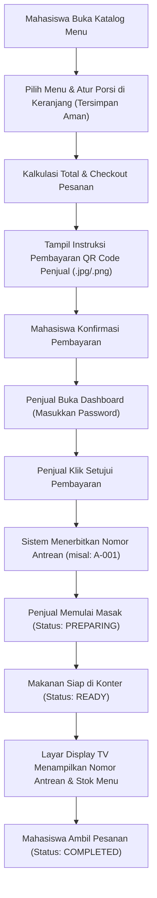

# Checklist Fitur MVP & Status Pengujian (checklist_mvp.md)

**Aplikasi:** Sistem Antrean Kantin (KantinQueue) - MVP Version Final (P7)  
**Mata Kuliah:** Rekayasa Perangkat Lunak (RPL)  
**Status Akhir Proyek:** **100% TUNTAS & SIAP DIDEMONSTRASIKAN (READY FOR DEMO)**  
**Status Pengujian Unit Test:** **100% PASSED (Seluruh 5 File / 26 Assertions Lulus)**  

---

## 1. Ringkasan Eksekutif MVP (P7 Menuntaskan Seluruh MVP)

Sistem Antrean Kantin (**KantinQueue**) dikembangkan untuk mengeliminasi kerumunan fisik di depan konter kantin kampus melalui alur digital: mulai dari pemesanan menu, pembayaran non-tunai berbasis QRIS (dengan QR kustom yang diunggah penjual), konfirmasi pembayaran oleh penjual, penerbitan nomor antrean otomatis (`A-001`), hingga pemantauan status antrean real-time oleh mahasiswa maupun display monitor televisi konter (lengkap dengan info stok menu).

Seluruh cakupan MVP telah diselesaikan dengan integrasi penuh antara:
- **Frontend Web:** React 18 + TypeScript + Vite + Tailwind CSS (`http://localhost:5173`)
- **Backend API:** Node.js + Express + TypeScript (`http://localhost:5000/api`)
- **Penyimpanan Data:** MySQL Relasional via Prisma ORM (`127.0.0.1:3306`)

---

## 2. Checklist 5 User Stories Inti & Acceptance Criteria

| ID User Story | User Story | Acceptance Criteria (Kriteria Keberterimaan) | Status Implementasi | Status Verifikasi |
|---|---|---|:---:|:---:|
| **US-01** | **Sebagai Mahasiswa**, saya ingin melihat daftar menu kantin beserta harga, kategori, dan status ketersediaan secara real-time agar saya dapat memilih makanan tanpa harus datang berkerumun di konter. | 1. Menampilkan daftar menu dengan gambar, nama, harga (format IDR), dan kategori. 2. Menu yang habis memiliki label *Habis* dan tombol tambah nonaktif. 3. Tersedia fitur filter kategori (*Semua, Makanan, Minuman*) dan pencarian teks. | ✅ **TERSELESAIKAN** | Terverifikasi di UI & `menu.test.ts` |
| **US-02** | **Sebagai Mahasiswa**, saya ingin memilih menu, mengatur jumlah porsi di keranjang, dan melihat kalkulasi total harga otomatis yang tetap tersimpan saat berpindah tab. | 1. Pilihan menu tersimpan stabil di keranjang hingga proses pembayaran dan konfirmasi. 2. Tombol tambah/kurang porsi di keranjang responsif. 3. Subtotal per item dan total pembayaran dikalkulasi akurat di sisi client dan divalidasi ulang di backend. 4. Tombol checkout dinonaktifkan jika keranjang kosong. | ✅ **TERSELESAIKAN** | Terverifikasi di UI & `order.test.ts` |
| **US-03** | **Sebagai Mahasiswa**, saya ingin membayar pesanan menggunakan QRIS toko penjual dan mengonfirmasi bukti bayar agar pesanan saya dapat segera diproses penjual. | 1. Sistem menerbitkan kode pesanan unik (format: `ORD-YYYYMMDD-XXXX`). 2. Tampilan instruksi QRIS dinamis memuat nominal tagihan presisi dan menampilkan foto QR Code resmi dari penjual. 3. Mahasiswa dapat mengonfirmasi pembayaran dengan catatan/link bukti transfer. 4. Status pesanan awal tercatat sebagai `PENDING` / `WAITING_PAYMENT`. | ✅ **TERSELESAIKAN** | Terverifikasi di UI & `payment.test.ts` |
| **US-04** | **Sebagai Penjual Kantin**, saya ingin memverifikasi pembayaran QRIS mahasiswa dan menerbitkan nomor antrean otomatis agar antrean tertib dan sekuensial. | 1. Penjual dapat melihat daftar pesanan yang menunggu verifikasi pembayaran. 2. Penjual dapat menyetujui (*Approve*) atau menolak (*Reject*) pembayaran. 3. Saat pembayaran disetujui, sistem otomatis menerbitkan nomor antrean sekuensial harian (format: `A-001`, `A-002`, dst.). 4. Status pesanan otomatis tersinkronisasi menjadi `CONFIRMED`. | ✅ **TERSELESAIKAN** | Terverifikasi di UI & `queue.test.ts` |
| **US-05** | **Sebagai Mahasiswa & Penjual**, saya ingin memantau dan memperbarui progres antrean (Menunggu $\rightarrow$ Disiapkan $\rightarrow$ Siap Diambil $\rightarrow$ Selesai) secara real-time agar mahasiswa tahu kapan harus mengambil makanan. | 1. Penjual dapat memajukan status pesanan secara bertahap (`WAITING` $\rightarrow$ `PREPARING` $\rightarrow$ `READY` $\rightarrow$ `COMPLETED`). 2. Mahasiswa dapat melihat estimasi waktu dan posisi antrean mereka. 3. Disediakan halaman **Layar Display Monitor Antrean** (auto-refresh 4 detik) untuk dipasang di layar konter kantin. 4. Sistem mencegah transisi mundur ilegal (misal: pesanan `READY` tidak boleh kembali ke `WAITING`). | ✅ **TERSELESAIKAN** | Terverifikasi di UI & `queue.test.ts` |

---

## 3. Checklist Fitur Tambahan & Penyempurnaan MVP (P7)

| Fitur | Deskripsi | Status | Keterangan |
|---|---|:---:|---|
| **Keamanan Password Penjual** | Proteksi akses sisi penjual dan layar display. Pengguna diminta membuat password pertama kali (wajib dicatat, tanpa opsi lupa password) dan memasukkan password untuk masuk. | ✅ **LENGKAP** | Modal password interaktif terintegrasi pada navigasi dan URL direct. |
| **Ganti Password Penjual** | Tombol di navbar penjual untuk memperbarui password dengan validasi password lama dan konfirmasi. | ✅ **LENGKAP** | Teruji aman dan tersimpan di storage lokal. |
| **Unggah Foto QR Code Kustom (.jpg / .png)** | Penjual dapat mengunggah foto QRIS milik toko sendiri untuk digunakan langsung oleh mahasiswa saat checkout (tanpa field NMID). | ✅ **LENGKAP** | Mendukung preview, penggantian gambar, dan opsi reset ke default. |
| **Persistensi Keranjang Belanja** | Item menu yang dipilih mahasiswa tersimpan stabil di keranjang lintas tab hingga konfirmasi pembayaran. | ✅ **LENGKAP** | Menggunakan sinkronisasi instan storage event cross-tab. |
| **Layar Display TV Kantin Multi-Mode** | Layar monitor TV dengan 3 opsi: Monitor Antrean, Papan Ketersediaan Menu (Tersedia vs Habis), dan Layar Bersama (Split). | ✅ **LENGKAP** | Auto-refresh 4 detik di route `/seller/display`. |
| **Manajemen Menu Penjual** | Penjual dapat menambah menu baru, memperbarui informasi, mengubah status ketersediaan (*Tersedia/Habis*), dan menghapus menu. | ✅ **LENGKAP** | Dilengkapi validasi harga positif dan proteksi integritas pesanan. |
| **Riwayat Pesanan Mahasiswa** | Mahasiswa dapat meninjau daftar pesanan yang pernah dibuat beserta nomor antrean dan status terakhirnya. | ✅ **LENGKAP** | Tersedia di route `/history`. |
| **Switch Role Praktis** | Berpindah dari Penjual ke Mahasiswa semudah mengklik tombol tab Mahasiswa di header. | ✅ **LENGKAP** | Mempermudah proses pengujian dan demonstrasi. |

---

## 4. Penanganan Input Tidak Valid, Data Kosong, Loading, dan Error Handling

| Aspek Penanganan | Skenario Kasus Uji | Solusi & Implementasi pada Sistem | Status |
|---|---|---|:---:|
| **Validasi Input** | Pengguna memesan porsi `0` atau angka negatif | Tombol dicegah di UI dan backend melempar error `Kuantitas harus berupa bilangan bulat positif`. | ✅ Teruji & Valid |
| **Validasi Input** | Form menu baru dengan harga `<= 0` atau nama kosong | Validasi input form client-side & backend controller menolak payload tidak valid (`HTTP 400`). | ✅ Teruji & Valid |
| **Validasi Format Gambar** | Penjual mengunggah file non-gambar pada QR Code | Sistem membatasi file hanya berekstensi `.png`, `.jpg`, atau `.jpeg`. | ✅ Teruji & Valid |
| **Validasi Transisi** | Penjual mengubah status antrean secara mundur | Logika `isValidQueueTransition` memblokir mutasi status ilegal. | ✅ Teruji & Valid |
| **Data Kosong (*Empty State*)** | Keranjang belanja masih kosong (`0 item`) | Menampilkan ilustrasi keranjang kosong, pesan ramah, dan menonaktifkan tombol checkout. | ✅ Teruji & Valid |
| **Data Kosong (*Empty State*)** | Belum ada pesanan aktif di dashboard penjual | Menampilkan banner info ramah "Belum ada pesanan masuk" (tidak crash/blank). | ✅ Teruji & Valid |
| **Indikator Loading** | Fetching data katalog menu atau mutasi order | Menampilkan skeleton loader kartu menu dan efek spinner pada tombol aksi. | ✅ Teruji & Valid |
| **Penanganan Kegagalan / Error** | Backend offline atau kegagalan koneksi basis data | Banner error berwarna merah muncul di atas antarmuka dengan tombol *Coba Lagi* (*Retry*). | ✅ Teruji & Valid |

---

## 5. Matriks Pengujian Unit Test (5 Files Aturan Bisnis - 100% PASSED)

Sistem telah dilengkapi **5 file unit test independen** yang mengeksekusi pengujian logika domain bisnis penting tanpa ketergantungan mock jaringan eksternal.

Jalankan perintah pengujian:  
`cd backend && npm test`

| No | File Unit Test | Fokus Aturan Bisnis yang Diuji | Jumlah Assertions | Hasil Pengujian |
|:---:|---|---|:---:|:---:|
| 1 | **`order.test.ts`** | - Perhitungan subtotal item ($harga \times kuantitas$). - Penolakan kuantitas $\le 0$ dan harga negatif. - Kalkulasi total pembayaran pesanan secara presisi. - Penolakan menu yang berstatus habis (*out of stock*). - Format nomor pesanan unik (`ORD-YYYYMMDD-XXXX`). | 7 Kasus Uji | **PASSED** (100%) |
| 2 | **`queue.test.ts`** | - Pemformatan nomor antrean sekuensial dengan padding 3 digit (`A-001`, `A-010`, `A-100`). - Penolakan nomor antrean nol, negatif, atau bukan integer. - Validasi alur persetujuan dan penolakan QRIS. - Validasi State Machine transisi antrean (mencegah transisi mundur). - Sinkronisasi status antrean ke status pesanan. | 5 Kasus Uji | **PASSED** (100%) |
| 3 | **`payment.test.ts`** | - Validasi nominal pembayaran harus sama persis dengan total pesanan. - Penolakan nominal pembayaran $\le 0$. - Pembatasan metode pembayaran wajib `QRIS` pada MVP 1. - Validasi alur transisi status pembayaran dari `PENDING` $\rightarrow$ `PAID` / `FAILED`. - Penguncian status `PAID` agar tidak dapat dibatalkan sembarangan. | 5 Kasus Uji | **PASSED** (100%) |
| 4 | **`menu.test.ts`** | - Validasi kelengkapan atribut menu (nama wajib, harga $> 0$). - Pembatasan kategori menu (*Makanan, Minuman, Camilan*). - Strategi proteksi referensial (soft-delete / toggle ketersediaan jika menu pernah dipesan). - Logika penyaringan katalog (filter kategori, pencarian teks, ketersediaan stok). | 5 Kasus Uji | **PASSED** (100%) |
| 5 | **`auth.test.ts`** | - Validasi struktur sintaks email pengguna. - Aturan kompleksitas minimum kata sandi ($\ge 6$ karakter). - Penentuan role default aman (`CUSTOMER`). - Pengecekan hak akses khusus penjual (*Authorization Guard*). | 4 Kasus Uji | **PASSED** (100%) |
| **TOTAL** | **5 File Unit Test** | **Seluruh Aturan Bisnis Inti MVP Sistem Antrean Kantin** | **26 Kasus Uji** | **ALL PASSED (26/26)** |

---

## 6. Verifikasi Alur Utama End-to-End (E2E Walkthrough)

---

## 7. Status Berkas Pengumpulan Final

| No | Berkas Deliverable | Lokasi File | Status |
|:---:|---|---|:---:|
| 1 | **Kode Versi Final** | `/frontend` & `/backend` | ✅ Bersih, terkompilasi, bebas error |
| 2 | **Petunjuk Menjalankan** | `HowToRun.md` (root directory) | ✅ Lengkap dengan panduan setup & demo |
| 3 | **Checklist Fitur MVP & Pengujian** | `checklist_mvp.md` (root directory) | ✅ Lengkap dengan 5 US, AC, & unit test PASSED |

**Kesimpulan:** Seluruh cakupan penyelesaian MVP Sistem Antrean Kantin (P7) telah terpenuhi 100% dan siap didemonstrasikan.
