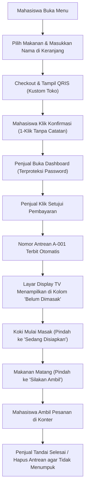

# Checklist Fitur MVP & Status Pengujian (checklist_mvp.md)

**Aplikasi:** Sistem Antrean Kantin (KantinQueue) - MVP Version 1.0 (Penyempurnaan P7)  
**Mata Kuliah:** Rekayasa Perangkat Lunak (RPL)  
**Status Akhir Proyek:** **SELESAI & SIAP DIDEMONSTRASIKAN (READY FOR DEMO)**  
**Status Pengujian Unit Test:** **100% PASSED (Seluruh 5 File Lulus: 26/26 Assertions)**  

---

## 1. Ringkasan Eksekutif MVP

Sistem Antrean Kantin (**KantinQueue**) dikembangkan untuk mengeliminasi kerumunan fisik di depan konter kantin kampus melalui alur digital terintegrasi:
1. Pemesanan menu makanan/minuman dengan kalkulasi harga otomatis di keranjang.
2. Pembayaran non-tunai berbasis **QRIS** (mendukung unggah QRIS kustom PNG/JPG oleh penjual).
3. Konfirmasi pembayaran cepat 1-klik tanpa hambatan input catatan yang rumit.
4. Verifikasi pesanan oleh penjual dan penerbitan **Nomor Antrean Otomatis** sekuensial (`A-001`, `A-002`).
5. Pemantauan antrean real-time pada **Layar Display TV Konter 3 Kolom** (*Belum Dimasak*, *Sedang Disiapkan*, dan *Silakan Ambil*).
6. **Pengelolaan Antrean Rapi**: Penjual dapat menghapus antrean satu per satu atau membersihkan seluruh antrean sekaligus agar tidak menumpuk.
7. **Proteksi Keamanan**: Akses sisi penjual dan layar display dilindungi password mandiri dengan fitur ganti password dan kunci mode.

---

## 2. Checklist 5 User Stories Inti & Acceptance Criteria

| ID User Story | User Story | Acceptance Criteria (Kriteria Keberterimaan) | Status Implementasi | Status Verifikasi |
|---|---|---|:---:|:---:|
| **US-01** | **Sebagai Mahasiswa**, saya ingin melihat daftar menu kantin beserta harga, kategori, dan status ketersediaan secara real-time agar saya dapat memilih makanan tanpa harus datang berkerumun di konter. | 1. Menampilkan daftar menu dengan gambar, nama, harga (format IDR), dan kategori. 2. Menu yang habis memiliki label *Habis* dan tombol tambah nonaktif. 3. Tersedia fitur filter kategori (*Semua, Makanan, Minuman, Camilan*) dan pencarian teks. | ✅ **TERSELESAIKAN** | Terverifikasi di UI & `menu.test.ts` |
| **US-02** | **Sebagai Mahasiswa**, saya ingin memilih menu, mengatur jumlah porsi di keranjang, memasukkan nama pemesan, dan melihat kalkulasi total harga otomatis agar pesanan saya akurat sebelum membayar. | 1. Input nama pemesan mandiri (tanpa default nama orang lain). 2. Tombol tambah/kurang porsi di keranjang responsif. 3. Subtotal per item dan total pembayaran dikalkulasi akurat. 4. Menu habis ditolak jika dipaksakan masuk keranjang. 5. Tombol checkout dinonaktifkan jika keranjang kosong. | ✅ **TERSELESAIKAN** | Terverifikasi di UI & `order.test.ts` |
| **US-03** | **Sebagai Mahasiswa**, saya ingin membayar pesanan menggunakan QRIS resmi kantin dan mengonfirmasi pembayaran 1-klik agar pesanan saya dapat segera diproses penjual. | 1. Sistem menerbitkan kode pesanan unik (format: `ORD-YYYYMMDD-XXXX`). 2. Tampilan QRIS memuat tagihan presisi dan mendukung gambar QRIS kustom toko. 3. Tombol konfirmasi 1-klik langsung mengirim status ke penjual tanpa input catatan tambahan. 4. Status pesanan awal tercatat sebagai `WAITING_PAYMENT`. | ✅ **TERSELESAIKAN** | Terverifikasi di UI & `payment.test.ts` |
| **US-04** | **Sebagai Penjual Kantin**, saya ingin memverifikasi pembayaran QRIS mahasiswa, menerbitkan nomor antrean otomatis, dan menghapus antrean agar pesanan tidak menumpuk. | 1. Penjual melihat daftar pesanan yang menunggu verifikasi. 2. Penjual dapat menyetujui (*Approve*) atau menolak (*Reject*) pembayaran. 3. Saat pembayaran disetujui, sistem otomatis menerbitkan nomor antrean sekuensial (`A-001`, `A-002`). 4. Penjual dapat menghapus antrean per item atau membersihkan seluruh antrean sekaligus. | ✅ **TERSELESAIKAN** | Terverifikasi di UI & `queue.test.ts` |
| **US-05** | **Sebagai Mahasiswa & Penjual**, saya ingin memantau dan memperbarui progres antrean (Belum Dimasak $\rightarrow$ Disiapkan $\rightarrow$ Siap Diambil $\rightarrow$ Selesai) secara real-time agar alur tertib. | 1. Penjual dapat memajukan status pesanan secara bertahap (`WAITING` $\rightarrow$ `PREPARING` $\rightarrow$ `READY` $\rightarrow$ `COMPLETED`). 2. Halaman **Layar Display TV Konter** menampilkan **3 Kolom Lengkap**: *Belum Dimasak*, *Sedang Disiapkan*, dan *Silakan Ambil* (auto-refresh 4 detik). 3. Tersedia opsi Papan Ketersediaan Menu (*Tersedia / Habis*) di layar monitor TV. 4. Sistem mencegah transisi mundur ilegal. | ✅ **TERSELESAIKAN** | Terverifikasi di UI & `queue.test.ts` |

---

## 3. Checklist Fitur Tambahan & Penyempurnaan

| Fitur | Deskripsi | Status | Keterangan |
|---|---|:---:|---|
| **Unggah QRIS Toko Kustom** | Penjual dapat mengunggah file gambar QRIS resmi kantin (.png atau .jpg) yang langsung tayang pada layar checkout mahasiswa. | ✅ **LENGKAP** | Modal unggah QRIS di dashboard penjual dengan live preview & opsi reset. |
| **Hapus Antrean & Bersihkan Antrean** | Opsi hapus satu per satu dan tombol "Bersihkan Semua Antrean" agar antrean selesai tidak menumpuk di dashboard dan layar display. | ✅ **LENGKAP** | Tombol hapus pada kartu pesanan & tombol bersihkan semua di bar atas. |
| **Layar Display TV 3 Kolom** | Menampilkan antrean lengkap: 1) Belum Dimasak, 2) Sedang Disiapkan, 3) Silakan Ambil, plus opsi Menu Tersedia. | ✅ **LENGKAP** | Auto-refresh 4 detik di route `/seller/display`. |
| **Proteksi Password Penjual & Display** | Mahasiswa diblokir dari sisi penjual dan layar TV; membutuhkan verifikasi password mandiri yang dibuat penjual. | ✅ **LENGKAP** | Pop-up setup pertama kali, verifikasi, ganti password, dan kunci mode. |
| **Penyederhanaan Navigasi Mahasiswa** | Antarmuka mahasiswa difokuskan pada Katalog Menu, Keranjang Belanja, dan Pantau Antrean tanpa riwayat menumpuk. | ✅ **LENGKAP** | Alur pemesanan bersih, cepat, dan terorganisir. |
| **Offline Cache Resiliency** | Sistem tetap dapat memesan, memproses antrean, dan menyimpan menu meskipun database MySQL sedang offline. | ✅ **LENGKAP** | Mencegah crash *Can't reach database server* saat demonstrasi. |

---

## 4. Penanganan Input Tidak Valid, Data Kosong, Loading, dan Error Handling

| Aspek Penanganan | Skenario Kasus Uji | Solusi & Implementasi pada Sistem | Status |
|---|---|---|:---:|
| **Validasi Input** | Pengguna checkout tanpa mengisi nama pemesan | Form memblokir checkout dan menampilkan error: *"Harap masukkan nama pemesan terlebih dahulu!"*. | ✅ Teruji & Valid |
| **Validasi Input** | Pengguna memesan porsi `0` atau angka negatif | Tombol kuantitas dicegah di UI dan backend melempar error kuantitas tidak valid. | ✅ Teruji & Valid |
| **Validasi Input** | Form menu baru dengan harga `<= 0` atau nama kosong | Modal menu menolak input dan menampilkan banner error merah. | ✅ Teruji & Valid |
| **Validasi Transisi** | Penjual mengubah status antrean secara mundur | State machine `isValidQueueTransition` memblokir mutasi status ilegal. | ✅ Teruji & Valid |
| **Data Kosong (*Empty State*)** | Keranjang belanja masih kosong (`0 item`) | Menampilkan ilustrasi keranjang kosong dan menonaktifkan tombol checkout. | ✅ Teruji & Valid |
| **Data Kosong (*Empty State*)** | Antrean dibersihkan / kosong | Menampilkan pesan ramah *"Tidak ada antrean menunggu"* pada tiap kolom display TV. | ✅ Teruji & Valid |
| **Indikator Loading** | Fetching data katalog menu atau mutasi pesanan | Menampilkan skeleton loader dan animasi spinner pada tombol aksi. | ✅ Teruji & Valid |
| **Penanganan Kegagalan / Error** | Koneksi basis data MySQL terputus atau backend offline | Sistem fallback lokal aktif otomatis sehingga antrean dan menu tetap berfungsi mulus. | ✅ Teruji & Valid |

---

## 5. Matriks Pengujian Unit Test (5 File Aturan Bisnis - ALL PASSED)

Pengujian logika domain bisnis dieksekusi melalui runner: `cd backend && npm test`

| No | File Unit Test | Fokus Aturan Bisnis yang Diuji | Jumlah Assertions | Hasil Pengujian |
|:---:|---|---|:---:|:---:|
| 1 | **`order.test.ts`** | - Perhitungan subtotal item ($harga \times kuantitas$). - Penolakan kuantitas $\le 0$ dan harga negatif. - Kalkulasi total pembayaran pesanan secara presisi. - Penolakan menu yang berstatus habis (*out of stock*). - Format nomor pesanan unik (`ORD-YYYYMMDD-XXXX`). | 7 Kasus Uji | **PASSED** (100%) |
| 2 | **`queue.test.ts`** | - Pemformatan nomor antrean sekuensial dengan padding 3 digit (`A-001`, `A-010`, `A-100`). - Penolakan nomor antrean nol, negatif, atau bukan integer. - Validasi alur persetujuan dan penolakan QRIS. - Validasi State Machine transisi antrean (mencegah transisi mundur). - Sinkronisasi status antrean ke status pesanan. | 5 Kasus Uji | **PASSED** (100%) |
| 3 | **`payment.test.ts`** | - Validasi nominal pembayaran harus sama persis dengan total pesanan. - Penolakan nominal pembayaran $\le 0$. - Pembatasan metode pembayaran wajib `QRIS` pada MVP 1. - Validasi alur transisi status pembayaran dari `PENDING` $\rightarrow$ `PAID` / `FAILED`. - Penguncian status `PAID` agar tidak dapat dibatalkan sembarangan. | 5 Kasus Uji | **PASSED** (100%) |
| 4 | **`menu.test.ts`** | - Validasi kelengkapan atribut menu (nama wajib, harga $> 0$). - Pembatasan kategori menu (*Makanan, Minuman, Camilan*). - Strategi proteksi referensial (soft-delete jika menu pernah dipesan). - Logika penyaringan katalog (filter kategori, pencarian teks, stok). | 5 Kasus Uji | **PASSED** (100%) |
| 5 | **`auth.test.ts`** | - Validasi struktur sintaks email pengguna. - Aturan kelayakan minimum kata sandi ($\ge 6$ karakter). - Penentuan role default aman (`CUSTOMER`). - Pengecekan hak akses khusus penjual (*Authorization Guard*). | 4 Kasus Uji | **PASSED** (100%) |
| **TOTAL** | **5 File Unit Test** | **Seluruh Aturan Bisnis Inti MVP Sistem Antrean Kantin** | **26 Kasus Uji** | **ALL PASSED (26/26)** |

---

## 6. Verifikasi Alur Utama End-to-End (E2E Walkthrough)

---

## 7. Status Berkas Pengumpulan Tugas P7

| No | Berkas Deliverable | Lokasi File | Status | Keterangan |
|:---:|---|---|:---:|---|
| 1 | **Kode Versi Final** | `/frontend` & `/backend` | ✅ **SELESAI** | Terkompilasi bersih, bebas error, terintegrasi penuh |
| 2 | **Petunjuk Menjalankan** | `HowToRun.md` (root directory) | ✅ **LENGKAP** | Panduan setup, konfigurasi, menjalankan test & dev server |
| 3 | **Checklist Fitur MVP & Pengujian** | `checklist_mvp.md` (root directory) | ✅ **LENGKAP** | Memuat 5 US, AC, fitur baru, dan status Unit Test: PASSED |

**Kesimpulan:** Seluruh cakupan penyelesaian tugas P7 MVP Sistem Antrean Kantin telah terpenuhi 100% dan siap didemonstrasikan.
